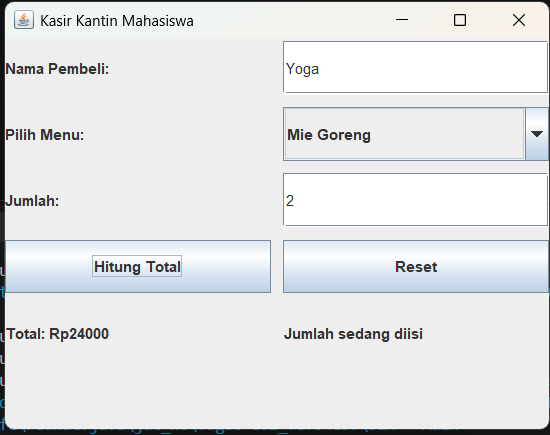

# Aplikasi Kasir Kantin Mahasiswa

**Nama:** Yoga Adiguna  
**NIM:** F1D02410028  
**Mata Kuliah:** Pemrograman Berorientasi Objek  
**Materi:** Graphical User Interface (GUI)

## 1. Deskripsi Program

Program ini merupakan aplikasi kasir kantin mahasiswa sederhana yang dibuat menggunakan bahasa pemrograman Java dengan library Swing. Aplikasi ini digunakan untuk menghitung total harga pembelian makanan atau minuman berdasarkan menu dan jumlah yang dimasukkan oleh pengguna.

Pengguna dapat memasukkan nama pembeli, memilih menu makanan atau minuman, memasukkan jumlah pembelian, kemudian menekan tombol Hitung Total untuk menampilkan total pembayaran. Selain itu terdapat tombol Reset untuk menghapus data yang sudah dimasukkan.

## 2. Top Level Container

Top Level Container merupakan komponen utama yang digunakan sebagai tempat untuk menampilkan seluruh komponen GUI,Pada program ini top Level Container yang digunakan adalah **JFrame**.

```java
public class KasirGUI extends JFrame implements ActionListener, KeyListener {
```

JFrame digunakan untuk membuat jendela utama aplikasi Kasir Kantin Mahasiswa. pengaturan seperti judul, ukuran jendela dan posisi tampilan dilakukan menggunakan method `setTitle()`, `setSize()`, dan `setLocationRelativeTo()`.

## 3. Intermediate Component

Intermediate Component merupakan komponen yang digunakan sebagai tempat untuk menampung dan mengelompokkan komponen GUI lainnya.

Pada program ini Intermediate Component yang digunakan adalah **JPanel**.

```java
JPanel panel = new JPanel();
```

JPanel digunakan untuk menampung komponen seperti JLabel, JTextField, JComboBox, dan JButton agar tampilan aplikasi lebih teratur.

## 4. Atomic Component

Atomic Component merupakan komponen GUI yang digunakan untuk menampilkan informasi atau menerima interaksi dari pengguna.

Pada program ini terdapat beberapa Atomic Component yaitu:

**a. JLabel**

Digunakan untuk menampilkan teks atau keterangan pada aplikasi seperti Nama Pembeli, Pilih Menu, Jumlah, dan total Pembayaran.

```java
JLabel namaLabel = new JLabel("Nama Pembeli:");
```

**b. JTextField**

Digunakan sebagai tempat pengguna memasukkan data berupa nama pembeli dan jumlah pembelian.

```java
namaField = new JTextField();
jumlahField = new JTextField();
```

**c. JComboBox**

Digunakan untuk menampilkan pilihan menu makanan dan minuman yang tersedia pada aplikasi.

```java
menuBox = new JComboBox<String>(menu);
```

**d. JButton**

Digunakan untuk membuat tombol yang dapat ditekan oleh pengguna yaitu tombol Hitung Total dan Reset.

```java
hitungButton = new JButton("Hitung Total");
resetButton = new JButton("Reset");
```

## 5. Layout Manager

Layout Manager digunakan untuk mengatur posisi dan susunan komponen pada tampilan GUI,pada program ini Layout Manager yang digunakan adalah **GridLayout**.

```java
panel.setLayout(new GridLayout(6, 2, 10, 10));
```

GridLayout digunakan untuk menyusun komponen dalam bentuk baris dan kolom, pada program ini komponen disusun dalam 6 baris dan 2 kolom dengan jarak horizontal dan vertikal sebesar 10 piksel.

## 6. Event Handling

Event Handling merupakan proses untuk menangani suatu aksi yang dilakukan oleh pengguna terhadap komponen GUI,pada program ini digunakan dua interface Event Handling yaitu **ActionListener** dan **KeyListener**.

### A. ActionListener

ActionListener digunakan untuk menangani aksi ketika pengguna menekan tombol pada aplikasi.

```java
hitungButton.addActionListener(this);
resetButton.addActionListener(this);
```

Event dari kedua tombol tersebut ditangani melalui method `actionPerformed()`.

```java
public void actionPerformed(ActionEvent e) {
    if (e.getSource() == hitungButton) {
    } else if (e.getSource() == resetButton) {
    }
}
```

Ketika tombol Hitung total ditekan, program akan menghitung total pembayaran berdasarkan harga menu dan jumlah pembelian sedangkan tombol Reset digunakan untuk mengembalikan input dan hasil perhitungan ke kondisi awal.

### B. KeyListener

KeyListener digunakan untuk mendeteksi aktivitas keyboard ketika pengguna mengetik pada kolom jumlah pembelian.

```java
jumlahField.addKeyListener(this);
```

Pada program ini method yang digunakan adalah `keyReleased()`.

```java
public void keyReleased(KeyEvent e) {
    if (jumlahField.getText().isEmpty()) {
        infoLabel.setText("Masukkan jumlah");
    } else {
        infoLabel.setText("Jumlah sedang diisi");
    }
}
```

Method tersebut dijalankan ketika pengguna melepaskan tombol keyboard, program akan menampilkan informasi berdasarkan kondisi kolom jumlah pembelian.

Selain `keyReleased()`, terdapat juga method `keyPressed()` dan `keyTyped()` sebagai bagian dari implementasi interface KeyListener.

## 7. Screenshot Hasil Program

Berikut merupakan screenshot hasil tampilan aplikasi Kasir Kantin Mahasiswa yang telah dijalankan.

